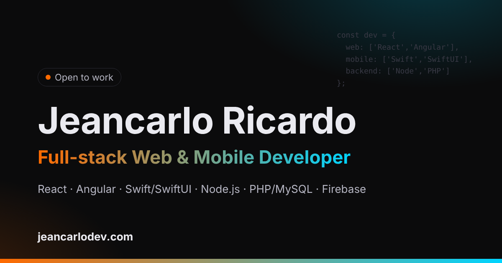

# jeancarlodev.com

Personal portfolio of **Jeancarlo Ricardo**, Full-stack Web & Mobile Developer based in Cambridge, Ontario.

**Live site:** [jeancarlodev.com](https://jeancarlodev.com)



## Featured projects

| Project | What it is | Stack |
| --- | --- | --- |
| [HolyVerse](https://apps.apple.com/ca/app/holy-verse/id6800918404) | Bilingual Bible study app, live on the App Store | JavaScript, Capacitor, Node.js, Firebase, Claude API |
| [AutoPulse](https://github.com/jeanvq/AutoPulse) | Full-stack vehicle maintenance web app (capstone) | PHP, MySQL, JavaScript, Docker, Railway |
| [AutoPulse iOS](https://github.com/jeanvq/AutoPulse-iOS) | Native vehicle health manager | SwiftUI, Firebase, Swift Charts, Claude API |
| [Global Explorer](https://github.com/jeanvq/Global-Explorer) | Country search app (team project) | Angular, REST Countries API |

See every project on the [All Projects](https://jeancarlodev.com/projects.html) page.

## Built with

- HTML5, CSS3 and vanilla JavaScript, no framework
- Custom animated particle background (`js/particles.js`)
- Responsive layout with light and dark themes
- Hosted on GitHub Pages with a custom domain

## Run it locally

```bash
git clone https://github.com/jeanvq/jeanvq.github.io.git
cd jeanvq.github.io
```

Open `index.html` with the VS Code **Live Server** extension.

## Contact

- Email: [jc.ricardovq@gmail.com](mailto:jc.ricardovq@gmail.com)
- LinkedIn: [jeancarlo-ricardo](https://linkedin.com/in/jeancarlo-ricardo-392b4a365)
- GitHub: [@jeanvq](https://github.com/jeanvq)
